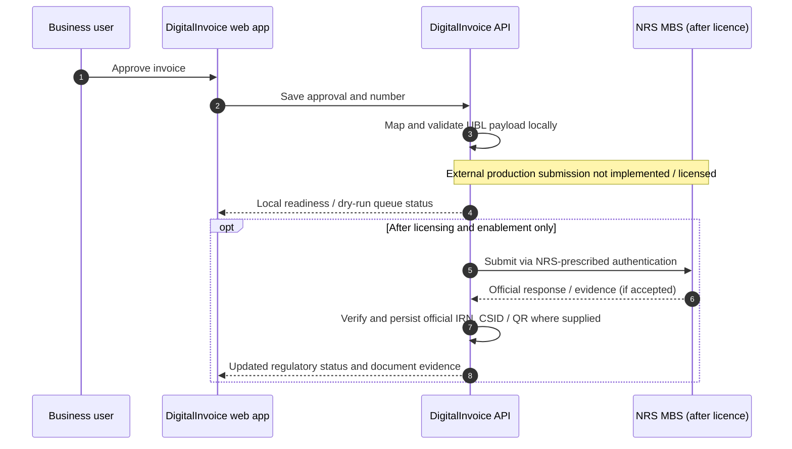

# DigitalInvoice API documentation

:::warning Integration availability and licensing
This reference documents interfaces **implemented in DigitalInvoice**, not a guarantee that every interface is enabled on the public server. ERP OAuth access and outbound webhooks are feature-gated and require deployment configuration. The production API origin is distributed privately during authorised integration provisioning; a public endpoint has **not been independently verified**. The NRS sandbox base URL is likewise supplied only through approved configuration. **Teecoms has not yet obtained an NRS MBS licence. External NRS production submission is disabled.** Local readiness and queue results are not NRS clearance, validation, an IRN or a CSID.
:::

## Overview

DigitalInvoice is an invoicing platform developed by Teecoms Integrated Solutions Limited. This document is for integrators and technical reviewers. It describes two **separate** interfaces:

1. **ERP integration API (v1):** OAuth 2.0 client-credentials access to **organisation-scoped, read-only** customer, item, invoice, credit-note, payment and local NRS-readiness information; signed outbound webhooks for selected events. This is the API intended for external ERP clients.
2. **Web application API:** cookie-based authenticated business workflows used by the DigitalInvoice web application. These include invoice creation, approval, payments and local NRS readiness. They are **not** writable ERP endpoints.

The ERP route descriptions reflect the DigitalInvoice integration API documented on **7 November 2026**; the NRS sandbox/resource sections incorporate the **13 November 2026 Phase 5 changes**. External sandbox acceptance and live NRS production access are separate from these API definitions.

## Environments and base URLs

| Environment | Address | Status |
| --- | --- | --- |
| DigitalInvoice web application | `https://app.digitalinvoice.ng` | Application address provided in project brief; live reachability not verified here |
| Production API | Supplied directly to authorised integration clients after deployment verification | API origin and mounted base path have not been independently verified |
| Sandbox / staging API | Provided through controlled onboarding if enabled | Sandbox credentials and access are deployment-dependent |
| NRS MBS | NRS-provided endpoint and credentials | Sandbox-gated adapter; external production submission disabled pending licensing |

All paths in this document are **relative to the DigitalInvoice API root** (the directory serving the PHP router, often mounted beneath `/api/`). For example, append `/oauth/token` to your **confirmed** API base URL. The ERP API's `/integrations/v1/` segment is **part of the route**, not a second hostname. Do not send ERP client credentials to the browser application or NRS.

## Authentication and security

### ERP access — OAuth 2.0 client credentials

A workspace owner or administrator creates a named ERP client, with only the read scopes it needs. The client identifier (`di_...`) and secret (`di_secret_...`) are returned on creation; the secret is shown **once**. Send these using **HTTP Basic** to [[METHOD:POST]] `/oauth/token` with `Content-Type: application/x-www-form-urlencoded`, `grant_type=client_credentials` and, optionally, a space-separated `scope` subset. The response is an OAuth bearer token; include it in `Authorization: Bearer ...` on versioned ERP read requests.

Access tokens are opaque, hashed in storage, and valid for **300–900 seconds** (default **900 seconds**); there is **no refresh token** in this flow. Client revocation, secret rotation and scope changes invalidate outstanding tokens. Requests are authorised against the database-assigned organisation, active/onboarded workspace, eligible subscription and requested scope. No client-provided organisation ID is trusted.

```bash
# Configure the actual deployed API root before running; no credentials in source control.
API_BASE_URL="${DIGITALINVOICE_API_BASE_URL:?Set your confirmed HTTPS API root}"
curl --request POST "${API_BASE_URL%/}/oauth/token" \
  --user "$ERP_CLIENT_ID:$ERP_CLIENT_SECRET" \
  --header 'Content-Type: application/x-www-form-urlencoded' \
  --data-urlencode 'grant_type=client_credentials' \
  --data-urlencode 'scope=customers:read invoices:read'
```

**Illustrative token response** (the token is deliberately a placeholder; the response has no `status` wrapper):

```json
{
  "access_token": "<REDACTED_EXAMPLE_ACCESS_TOKEN>",
  "token_type": "Bearer",
  "expires_in": 900,
  "scope": "customers:read invoices:read"
}
```

### ERP scopes

| Scope | Permitted read resources |
| --- | --- |
| `customers:read` | Customers list |
| `items:read` | Products and services list |
| `invoices:read` | Invoices list and invoice detail |
| `credit_notes:read` | Credit notes list and detail |
| `payments:read` | Payments list and detail |
| `nrs:read` | Local invoice/NRS queue readiness view, not external NRS operations |

:::warning No ERP write access
ERP OAuth tokens **cannot create, update, approve, reject or void invoices**, post payments, manage clients, or call NRS submission/signing endpoints. The backend does not expose public client self-registration, ERP API keys or a browser OAuth authorization-code flow.
:::

### Web application sessions, CSRF and MFA

Browser users authenticate with password or Google Sign-In, with authenticator-based TOTP MFA where required/enabled. A successful full sign-in issues an HS256 JWT access cookie (configured default **15 minutes**), a rotating refresh-session cookie (configured default **12 hours**, subject to inactivity and absolute session limits), and a readable CSRF cookie. Session cookies are HttpOnly; the CSRF token is readable so the frontend can send it with state-changing requests. `Secure` and `SameSite` cookie attributes are set by server configuration. The browser workflow uses:

1. [[METHOD:GET]] `/auth/csrf` to obtain the CSRF token.
2. [[METHOD:POST]] `/auth/login` or `/auth/google`; if MFA is required, complete [[METHOD:POST]] `/auth/mfa/verify` before receiving an authenticated session.
3. Send `X-CSRF-Token` with cookie-authenticated writes. [[METHOD:GET]] `/auth/session` reads the current session, [[METHOD:POST]] `/auth/refresh` renews it, and [[METHOD:POST]] `/auth/logout` ends it.

Workspace roles and feature permissions restrict browser operations. These cookie/CSRF/MFA rules **do not replace** OAuth authentication for ERP clients. The backend enforces HTTPS when `REQUIRE_HTTPS` is enabled, emits HSTS on HTTPS requests and restricts permitted browser origins. Actual TLS protocol versions and the deployed certificate must be verified at the hosting layer.

## API conventions

- **Transport:** HTTPS. Browser business routes primarily accept and return JSON; the OAuth token request takes URL-encoded form data. Outbound webhooks deliver JSON.
- **Standard business response:** `{"status":"success", "data":{...}}`, sometimes with `message`. Failures use `{"status":"failed", "message":"..."}`. **OAuth token and OAuth errors use OAuth-specific fields instead.**
- **ERP wrapper:** successful reads return `data.<resource_key>` plus `data.organization_id` and `data.api_version` (`v1`). A list resource includes its own `pagination` object.
- **Pagination:** `page` defaults to `1`; `limit` defaults to `20`, minimum `1`, maximum `100`; `pagination` includes `page`, `limit`, `total`, `total_pages`. Optional filters differ by resource.
- **Dates and amounts:** invoice/payment dates use `YYYY-MM-DD` and timestamps are returned as stored by the service; monetary amounts are decimal values (often serialized as strings) and accompanied by `currency` such as `NGN`. Do not assume timestamps are UTC unless specified.
- **Consistency:** lists are ordered by the resource service. Fetch current resource state when processing a webhook; do not infer it from an event alone.
- **Idempotency:** ERP v1 has **no write endpoints** and does **not** advertise an `Idempotency-Key` HTTP contract. For webhook consumers, deduplicate by delivery ID or event ID. Do not retry non-idempotent browser writes automatically without checking the resource state.

## Errors and limits

| HTTP status | Meaning | Relevant context |
| --- | --- | --- |
| `400` | Bad request / invalid grant or input | OAuth form/grant validation; JSON parse errors |
| `401` | Invalid client credentials or missing/expired bearer token | OAuth token or ERP read |
| `403` | Insufficient scope or permission / transport restriction | Scope and browser access checks |
| `404` | Route or organisation-scoped resource not found | Missing record or wrong tenant |
| `419` | Browser CSRF validation failed | Cookie-authenticated state-changing call |
| `422` | Invalid ID, filters or business input | ERP resource argument validation |
| `429` | Rate limit reached | OAuth token issuance or browser sign-in |
| `500` | Unhandled/server error | Contact support with request context, not secrets |
| `503` | ERP integration disabled | ERP feature flag not enabled |

**Example ERP error:**

```json
{
  "status": "failed",
  "message": "ERP token does not include the required scope: invoices:read"
}
```

**Example OAuth error:**

```json
{
  "error": "invalid_client",
  "error_description": "Invalid client credentials."
}
```

The backend currently limits OAuth token issuance to **60 requests per client per rolling minute** (counted from issued-token records). Password sign-in also has configurable failed-attempt throttling. **No general per-resource ERP request quota or response-rate guarantee is established in the supplied code.** Handle `429` and transient `5xx` with bounded exponential backoff and jitter; never retry bad credentials indefinitely.

## Invoice lifecycle

The following is the **browser business workflow**, **not** an ERP write capability. Invoice numbers are assigned on approval. A rejected invoice may be corrected according to browser permissions. Payment status (`unpaid`, `partially_paid`, `paid`) is separate from approval status. The database also recognises `void`, but this archive does not expose a verified ERP or browser endpoint that voids an approved invoice; no such transition is depicted.

```mermaid
stateDiagram-v2
    [*] --> draft: Create invoice
    draft --> pending_approval: Submit for approval
    pending_approval --> approved: Approve; assign invoice number
    pending_approval --> rejected: Reject
    rejected --> draft: Correct / resubmit workflow
    note right of approved
      Payment allocation and NRS readiness are separate.
      ERP v1 can READ but cannot change these states.
    end note
```




| Action | Browser route | Required access / constraint |
| --- | --- | --- |
| Create or edit draft | [[METHOD:POST]] `/invoices`; [[METHOD:PUT]] `/invoices` | Workspace invoice create/edit permission and workflow validation |
| Submit | [[METHOD:POST]] `/invoices/submit-for-approval` | `invoices.edit`, subject to editable state |
| Approve / reject | [[METHOD:POST]] `/invoices/approve`; [[METHOD:POST]] `/invoices/reject` | Approver permissions and valid pending state |
| Record and allocate payment | [[METHOD:POST]] `/payments`; [[METHOD:POST]] `/payments/allocate` | Payment permissions; invoice payment state updated locally |
| Read state (ERP) | [[METHOD:GET]] `/integrations/v1/invoice?id=123` | `invoices:read` only |

## ERP integration endpoint reference

:::info Paths and feature gates
All ERP paths below are relative to the **confirmed API root**. The OAuth token request and read endpoints require `ERP_INTEGRATIONS_ENABLED=1`; outbound delivery additionally requires `ERP_WEBHOOKS_ENABLED=1` and a scheduled dispatch worker. Workspace owners/admins configure clients and webhooks through **browser-session + CSRF** management routes, not machine bearer tokens.
:::

### POST /oauth/token

[[METHOD:POST]] `/oauth/token`

**Authentication:** HTTP Basic using the one-time ERP client identifier and secret. **Body:** `application/x-www-form-urlencoded` with `grant_type=client_credentials` (required) and optional `scope` (space-separated subset of granted read scopes). **Response:** `access_token`, `token_type` (`Bearer`), `expires_in` and `scope`; `Cache-Control: no-store`. The sample request and response appear under [ERP access](#erp-access-oauth-20-client-credentials).

### GET /integrations/v1/customers

[[METHOD:GET]] `/integrations/v1/customers`

**Scope:** `customers:read`. Optional `page`, `limit`, `search`, `type` (`business`, `individual`, `government`, `international`), `status` (`active`, `inactive`, `archived`, `all`; default `active`). Returns a `customers` array and `pagination` object.

```bash
curl --get "${API_BASE_URL%/}/integrations/v1/customers" \
  --header "Authorization: Bearer $ERP_ACCESS_TOKEN" \
  --data-urlencode 'page=1' --data-urlencode 'limit=20' \
  --data-urlencode 'status=active'
```

**Illustrative successful response** (fictional records and IDs):

```json
{
  "status": "success",
  "data": {
    "customers": {
      "customers": [{
        "id": 101,
        "customer_code": "CUS-000101",
        "customer_type": "business",
        "name": "Example Buyer Limited",
        "email": "buyer@example.invalid",
        "preferred_currency": "NGN",
        "city": "Lagos",
        "country": "NG",
        "is_active": 1
      }],
      "pagination": {"page": 1, "limit": 20, "total": 1, "total_pages": 1}
    },
    "organization_id": 42,
    "api_version": "v1"
  }
}
```

### GET /integrations/v1/items

[[METHOD:GET]] `/integrations/v1/items`

**Scope:** `items:read`. Optional `page`, `limit`, `search`, `type` (`product` or `service`), `status` (`active`, `inactive`, `archived`, `all`; default `active`). Response resource key: `data.items`, containing an `items` array and `pagination`.

### GET /integrations/v1/invoices

[[METHOD:GET]] `/integrations/v1/invoices`

**Scope:** `invoices:read`. Optional `page`, `limit`, `search`, `status` (`all`, `draft`, `pending_approval`, `approved`, `rejected`, `void`), `customer_id`, `date_from`, `date_to` (`YYYY-MM-DD`), and `firs_compliance` (`all`, `not_checked`, `ready`, `blocked`). Response resource key: `data.invoices`, containing an `invoices` array and `pagination`.

```bash
curl --get "${API_BASE_URL%/}/integrations/v1/invoices" \
  --header "Authorization: Bearer $ERP_ACCESS_TOKEN" \
  --data-urlencode 'status=approved' --data-urlencode 'page=1'
```

### GET /integrations/v1/invoice

[[METHOD:GET]] `/integrations/v1/invoice`

**Scope:** `invoices:read`. Required positive integer query parameter `id`. Returns `data.invoice` with the invoice and its details; always filtered to the ERP client's organisation. If the invoice is missing or archived, the route responds with `404`.

```bash
curl --get "${API_BASE_URL%/}/integrations/v1/invoice" \
  --header "Authorization: Bearer $ERP_ACCESS_TOKEN" \
  --data-urlencode 'id=123'
```

**Illustrative response excerpt** (fictional invoice; additional fields are omitted below for readability):

```json
{
  "status": "success",
  "data": {
    "invoice": {
      "id": 123,
      "invoice_number": "INV-000123",
      "status": "approved",
      "customer_name_snapshot": "Example Buyer Limited",
      "currency": "NGN",
      "total_amount": "107500.00",
      "payment_status": "unpaid",
      "nrs_submission_status": "not_submitted",
      "items": [{
        "item_name_snapshot": "Example service",
        "quantity": "1.0000",
        "unit_price": "100000.00",
        "taxable_amount": "100000.00",
        "tax_amount": "7500.00",
        "total_amount": "107500.00"
      }],
      "status_history": [],
      "payment_allocations": []
    },
    "organization_id": 42,
    "api_version": "v1"
  }
}
```

### GET /integrations/v1/credit-notes

[[METHOD:GET]] `/integrations/v1/credit-notes`

**Scope:** `credit_notes:read`. Optional `page`, `limit`, `search`, `status` (`all`, `draft`, `pending_approval`, `approved`, `rejected`, `void`), `date_from`, `date_to`. Response resource key: `data.credit_notes`, containing `credit_notes` and `pagination`.

### GET /integrations/v1/credit-note

[[METHOD:GET]] `/integrations/v1/credit-note`

**Scope:** `credit_notes:read`. Required positive integer query parameter `id`. Response resource key: `data.credit_note` with the local credit-note details, including original-invoice context where available. This does **not** mean an NRS-accepted credit note.

### GET /integrations/v1/payments

[[METHOD:GET]] `/integrations/v1/payments`

**Scope:** `payments:read`. Optional `page`, `limit`, `search`, `status` (`all`, `received`, `partially_allocated`, `allocated`, `void`), `method` (configured payment-method values), `customer_id`. Response resource key: `data.payments`, containing `payments` and `pagination`.

### GET /integrations/v1/payment

[[METHOD:GET]] `/integrations/v1/payment`

**Scope:** `payments:read`. Required positive integer query parameter `id`. Response resource key: `data.payment` (includes available allocation records). No ERP payment-posting route exists.

### GET /integrations/v1/nrs-status

[[METHOD:GET]] `/integrations/v1/nrs-status`

**Scope:** `nrs:read`. Required positive integer query parameter `id` for an invoice. Response resource key: `data.nrs_status`. This is a **local** invoice/queue status view. Its response explicitly contains `queue_mode: "dry_run"` and `external_submission_enabled: false`; official evidence is returned only if the backend's existing evidence-verification gate permits it.

```json
{
  "status": "success",
  "data": {
    "nrs_status": {
      "invoice_id": 123,
      "invoice_number": "INV-000123",
      "workflow_status": "approved",
      "local_readiness": "not_checked",
      "queue": null,
      "nrs_evidence": {"verified": false, "message": "Not yet submitted to NRS"},
      "queue_mode": "dry_run",
      "external_submission_enabled": false
    },
    "organization_id": 42,
    "api_version": "v1"
  }
}
```

:::warning Local status is not clearance
A local `ready` result or queued job must **never** be presented as NRS acceptance. Do not generate, invent or persist official IRN, CSID or QR evidence from example values.
:::

## Integration administration — browser session only

The following **implemented** management routes use the **web user's session and CSRF token** and require an active, completed workspace, eligible subscription, and role `owner` or `admin`. They are not callable using an ERP bearer token.

| Method | Route | Request / outcome |
| --- | --- | --- |
| [[METHOD:GET]] | `/integrations/clients` | List up to 100 clients; includes allowed scopes, no secrets |
| [[METHOD:POST]] | `/integrations/clients` | JSON `{"name":"Example ERP", "scopes":["customers:read","invoices:read"]}`; returns client ID/secret **once**, HTTP `201` |
| [[METHOD:PUT]] | `/integrations/clients` | JSON `{"id":12,"action":"rotate_secret"}` or `revoke`; `update_scopes` also accepts `scopes` array; revokes issued tokens |
| [[METHOD:GET]] | `/integrations/webhooks` | List up to 100 destinations and supported event types; no secrets |
| [[METHOD:POST]] | `/integrations/webhooks` | JSON with `name`, public HTTPS `url`, nonempty `events` array; returns signing secret **once**, HTTP `201` |
| [[METHOD:PUT]] | `/integrations/webhooks` | JSON with `id`, `action` (`update`, `disable`, `rotate_secret`); update requires `url` and `events` |
| [[METHOD:GET]] | `/integrations/webhooks/deliveries` | Latest 100 deliveries with status, attempts, next attempt and HTTP result |

Clients and webhooks cannot be self-provisioned anonymously. New and rotated client credentials or webhook secrets should be stored immediately in a secret manager. Keep web application CSRF credentials separate from machine OAuth tokens.

## Outbound signed webhooks

### Events and delivery contract

The implementation supports these outbound event types: `customer.created`, `customer.updated`, `invoice.created`, `invoice.updated`, `invoice.approved`, `credit_note.approved`, `payment.recorded`, `payment.voided`.

Events are placed in a database outbox when eligible business audit events occur **and both ERP feature gates are enabled**. A separate CLI worker dispatches selected events to registered **public HTTPS** destinations (port 443, no redirect; private, loopback and other prohibited addresses are rejected). The delivery worker is not a continuously running server process automatically started by the website.

The worker retries eligible failures with exponential backoff, up to **8 attempts**, and stops for most permanent `4xx` responses (except `408`/`429`). Delivery is **at least once**. Webhook consumers must deduplicate and use a scoped ERP `GET` to retrieve current state. Never interpret an event as proof of NRS submission.

### Headers and HMAC-SHA256 signature

| Header | Purpose |
| --- | --- |
| `X-DigitalInvoice-Event` | Event type, e.g. `invoice.approved` |
| `X-DigitalInvoice-Delivery` | Numeric unique delivery ID (deduplication) |
| `X-DigitalInvoice-Timestamp` | Unix seconds used in signature |
| `X-DigitalInvoice-Signature` | `v1=` followed by lowercase hex HMAC-SHA256 |
| `Content-Type` | `application/json` |

Compute the HMAC using the **exact raw request body**, not re-serialized JSON. The message to sign is `<timestamp>.<raw_json_body>`, keyed by the one-time `whsec_...` secret. Compare in constant time; reject old timestamps (for example, older than 300 seconds) and duplicate delivery IDs. Keep the signing secret out of browser code and logs.

```javascript
import { createHmac, timingSafeEqual } from 'node:crypto'

function verifyDigitalInvoiceWebhook({ timestamp, rawBody, signature, secret }) {
  const sentAt = Number(timestamp)
  if (!Number.isSafeInteger(sentAt) || Math.abs(Date.now() / 1000 - sentAt) > 300) return false
  const expected = createHmac('sha256', secret).update(`${timestamp}.${rawBody}`).digest('hex')
  const supplied = /^v1=([0-9a-f]{64})$/.exec(signature || '')
  if (!supplied) return false
  return timingSafeEqual(Buffer.from(expected, 'hex'), Buffer.from(supplied[1], 'hex'))
}
// Additionally store X-DigitalInvoice-Delivery durably and reject repeats.
```

**Illustrative event body** (fictional ID):

```json
{
  "id": "evt_314",
  "type": "invoice.approved",
  "api_version": "v1",
  "created_at": "2026-11-07T12:00:00+00:00",
  "data": {"object": "invoice", "id": 123},
  "note": "Fetch current resource state using a scoped ERP access token."
}
```

## NRS MBS integration — separate, licence-gated system

DigitalInvoice contains a local UBL payload adapter, readiness validation, queue records, and a sandbox-gated NRS client. Those components **do not establish** that the service is licensed, connected to NRS production or that any invoice has received an official IRN, CSID or QR code. The external submission and response-verification process remains licence-gated.

The following Mermaid sequence shows the **intended production flow after licensing**, **not the current executed flow**:




### Browser readiness operations (not ERP OAuth)

| Method | Browser route | Required access | Meaning |
| --- | --- | --- | --- |
| [[METHOD:GET]] | `/firs/status` | `reports.view` | Workspace readiness configuration/status |
| [[METHOD:GET]] | `/firs/options` | Active product/workspace access | Local options and cached code-list availability |
| [[METHOD:GET]] | `/firs/classification-codes` | `catalogue.view` | Classification code lookup/state |
| [[METHOD:GET]] | `/firs/submission-queue` | `invoices.view` | Local submission-queue tracking |
| [[METHOD:POST]] | `/firs/invoice-readiness` | `invoices.view`; body `{ "invoice_id": 123 }` | Local UBL validation plus `official_code_preflight`; no external NRS call |
| [[METHOD:POST]] | `/firs/credit-note-readiness` | `credit_notes.view` | Local credit-note validation; no NRS acceptance implied |
| [[METHOD:POST]] | `/firs/sandbox-invoice-validate` | `invoices.approve`; JSON `{ "invoice_id": 123 }` | **Authorised sandbox** NRS `/validate` request for an approved invoice only; never signs, submits, clears or stores production evidence |

The client contains safeguards for external calls, and queue processing has licence/production gates. Actual NRS endpoint URLs, credentials, response formats and availability are governed by official NRS onboarding material and must not be inferred from local samples.

### Phase 5 — authorised sandbox reference synchronisation

Platform administrators with the `platform.firs.manage` permission can request **one approved reference catalogue at a time** using the existing NRS/MBS admin screen. The public ERP OAuth API does **not** expose this operation. Supported catalogue keys are `invoice_types`, `payment_means`, `tax_categories`, `currencies`, `quantity_codes`, `hs_codes`, `service_codes`, `states` and `lgas`. The older `unit_codes` catalogue is local-only.

A sync requires saved NRS sandbox credentials, an approved HTTPS sandbox origin and explicit `NRS_SANDBOX_HTTP_ENABLED=1` configuration. The backend accepts an authenticated provider response only if its HTTP/envelope status and every code entry pass checks; then it atomically records the fetched catalogue as `synced`. A manual entry remains `manual_seed`; invalid or failed provider responses **preserve the existing cache**. Large resources exceeding the sandbox transport's 2 MiB response limit may fail safely; successful full-catalogue synchronisation has **not** been independently evidenced.

### Phase 5 — official-code preflight and sandbox validation

Local invoice readiness now includes `official_code_preflight`, comparing the prepared UBL-style JSON with **authenticated `synced`** lists for invoice type, currencies, payment means, supplier/buyer state and LGA, line unit codes, goods HS or service classification codes, and tax categories. A missing, manually seeded or mismatched catalogue causes this additional preflight to fail; it does not change existing invoice monetary calculations or approval status.

The separate browser-session operation [[METHOD:POST]] `/firs/sandbox-invoice-validate` uses `invoices.approve` permission, session/CSRF protection and an approved **B2B or B2C** invoice snapshot. It requires a valid NRS-issued Business ID and eight-character Service ID, an alphanumeric IRN component, successful local UBL checks and a passing official-code preflight before an authorised HTTP request to the NRS sandbox `/validate` endpoint. **This endpoint has no new public UI or ERP bearer-token access.** It sends real invoice details to an external sandbox; use only approved test data with the necessary authorisation.

Its returned summary includes `environment: "sandbox"`, `operation: "validate"`, `validation_response_ok`, and explicit `invoice_submitted: false`, `invoice_cleared: false`, `production_evidence: false` fields. A successful response is a **sandbox validation test**, not an IRN issuance, sign, confirm, transmit or clearance event. No production NRS evidence record or invoice submission queue state is updated.

:::warning Existing invoice-number constraint
The current issued-number format may include hyphens (for example `INV-000001`); Phase 5 rejects such numbers for NRS IRN construction rather than silently stripping characters. A persisted, collision-safe NRS invoice alias and an approved reconciliation strategy are still required before these invoices can pass the sandbox request preflight.
:::

### Signing and production activation checks

The new X.509 inspection helper checks an **ECDSA public certificate**, supported curve, validity window and SHA-256 fingerprint. It separately reports gaps for secure HSM/KMS key custody, independent JAdES tests and certificate enrolment. **No private-key signature or JAdES message is created.** Production readiness checks are advisory: `production_submission_enabled` stays **false** even when individual prerequisites are met. The existing queue remains dry-run only.

## NRS API v1.1 changes and authentication boundary — 13 November 2026

The external NRS API uses **`x-api-key` and `x-api-secret`** headers as described by its [authentication guide](https://einvoice.nrs.gov.ng/docs/authentication). DigitalInvoice's **ERP clients use OAuth 2.0 bearer tokens instead**. These credential systems are separate. The supplied PHP NRS sandbox client constructs `POST /api/v1/invoice/validate` and related operations only after a strict sandbox gate. Never send NRS secrets through the public ERP API or include them in downloadable examples.

The [official NRS v1.1 changelog](https://einvoice.nrs.gov.ng/changelog) includes the April 2026 `PARTIAL` payment update and quantity-code resource, February 2026 tax category additions, and December 2025 invoice kinds `B2B`, `B2C`, `B2G` and `G2B`. The supplied local adapter already maps invoice payments marked `partially_paid` to `PARTIAL` and recognises the NRS quantity-code resource. **The latest backend now implements authenticated sandbox resource-sync operations and an official-code preflight, but neither a completed provider sync in deployment nor an authorised sandbox acceptance test has been evidenced. There is still no production `/update` payment sender or B2G/G2B invoice workflow.**

The NRS [System Integrator requirements](https://einvoice.nrs.gov.ng/serivce-providers/system-integrators) describe cryptographic stamping with **ECDSA** and **JAdES** signatures. The backend has a sandbox-gated remote `sign` operation plus **ECDSA certificate inspection and signing-readiness checks**; it does **not** implement a verified local JAdES/ECDSA signer. Whether DigitalInvoice or an authorised Access Point Provider must apply specific signatures must be resolved in the licensed integration design. The [NRS System Integrator guidance](https://einvoice.nrs.gov.ng/serivce-providers/system-integrators) remains authoritative for signing responsibilities and approved service-provider roles.


## Data structure and schema

The NRS mapping derives from the backend's **local UBL JSON schema, UBL adapter, generated fixtures and SQL migrations**. The intended public mapping covers supplier, buyer, invoice metadata, lines, discounts, tax categories, monetary totals, payment data, and references. Values such as local `firs_compliance_status` are **internal readiness fields**, not evidence of NRS acceptance.

The versioned machine-readable schema, field mapping CSV, and B2B/B2C/credit-note examples are **published** at [Data structure](/developers/data-structure/). DigitalInvoice tracks current NRS MBS technical documentation (v1.1) and updates its payload mapping as official change notices are published. This API reference intentionally avoids inventing official NRS field names or manually fabricating a compliant UBL payload.

## Versioning and changelog

| Date | Version | Change |
| --- | --- | --- |
| 2026-11-07 | `1.0` | Initial public documentation of verified v1 ERP OAuth read endpoints, administration, webhooks, browser session boundaries and NRS licence-gated readiness |
| 2026-11-13 | `1.1` (documentation only) | NRS v1.1 review, then Phase 5 reconciliation: sandbox reference-sync safeguards, official-code preflight, permission-controlled sandbox `/validate`, ECDSA certificate checks and unchanged production lock; ERP route version remains `/integrations/v1/` |

`/integrations/v1/` is the implemented ERP route version. Breaking changes are announced at least **90 days** in advance, as set out in section 11 of the [Service Level Agreement](/sla/); urgent security fixes may require a shorter notice period, with immediate notice. This reference documents DigitalInvoice API version **1.1** as of **25 November 2026**.

## Support and Service Level Agreement

For technical access, provisioning and integration issues, contact **info@teecomsintegratedsolutions.ng** or **+2347038020088** (Teecoms general contact channels shown on the website). Support hours, severity levels and escalation are defined in the [Service Level Agreement](/sla/), effective **27 November 2026**. For privacy and security, integration enquiries should not include client secrets, access tokens, customer records or webhook signing secrets. This API reference does not independently establish additional availability or rate-limit commitments.


